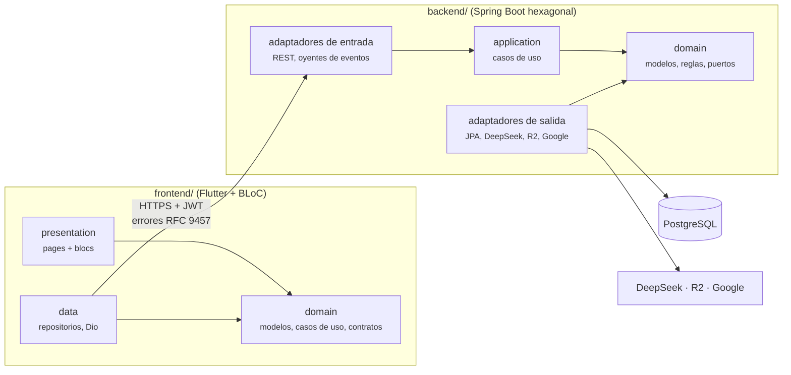

# Arquitectura de SynaptixFit

**Regla de dependencia:** las flechas apuntan siempre al dominio. Se comprueba con tests: `ArchitectureTest` (ArchUnit) en el backend y `test/architecture/dependency_rule_test.dart` en el cliente.

**Módulos del backend:** núcleo (auth, cuenta, XP), perfil y catálogo, entrenamiento, académico, planificador, gamificación, social, indicadores y administración. Cada tabla tiene un único dueño ([`data_model.md`](docs/01-architecture/data_model.md)) y los módulos se coordinan con eventos de dominio ([`events.md`](docs/01-architecture/events.md)).

**Errores:** técnico → genérico → dominio (`code`) → texto del cliente. Entre sistemas viajan como Problem Details (RFC 9457) con `code` ([`error_pipeline.md`](docs/01-architecture/error_pipeline.md), catálogo en [`errors.md`](docs/03-api/errors.md)).

Más detalle: [`docs/01-architecture/`](docs/01-architecture/) · decisiones: [`docs/02-adr/`](docs/02-adr/).
