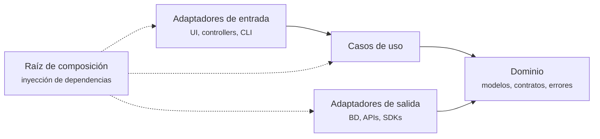
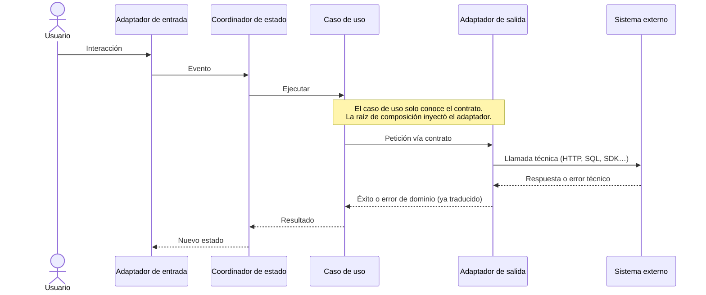
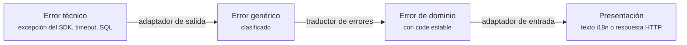

# Núcleo de arquitectura (agnóstico de tecnología)

> **Qué es:** las reglas que se cumplen en cualquier proyecto, sea cual sea el stack.
> **Qué no es:** una guía de Flutter, Spring ni de ninguna tecnología concreta. Eso vive en `profiles/`.
> **Cuándo leerlo:** antes de crear un proyecto, antes de añadir un perfil de stack y cuando dudes de dónde va algo.

---

## 1. La idea en una frase

El **dominio** está en el centro y no conoce a nadie. Todo lo demás (interfaz, base de datos, APIs, frameworks) son **adaptadores** intercambiables que dependen del dominio, nunca al revés.



Las flechas sólidas son dependencias de código. La raíz de composición es la única pieza que conoce a todas, porque su trabajo es conectarlas.

---

## 2. Catálogo de roles

Todo archivo de un proyecto cumple **uno** de estos roles. Cada perfil de stack indica en qué carpeta vive cada uno.

| Rol | Responsabilidad | Puede depender de | Nunca depende de |
|---|---|---|---|
| **Modelo de dominio** | Entidades y reglas de negocio puras | Nada (solo el lenguaje) | Frameworks, BD, red, UI |
| **Error de dominio** | Fallos de negocio con un `code` estable | Nada | Excepciones técnicas |
| **Contrato de repositorio** *(puerto de salida)* | Interfaz de lo que el dominio necesita del exterior | Modelos de dominio | Implementaciones concretas |
| **Caso de uso** *(puerto de entrada)* | Una acción del usuario o del sistema | Dominio y contratos | Adaptadores |
| **Adaptador de salida** | Implementa un contrato con una tecnología real | Dominio y contratos | Adaptadores de entrada |
| **Adaptador de entrada** | Recibe la intención (pantalla, endpoint, comando) y llama al caso de uso | Casos de uso y dominio | Adaptadores de salida |
| **Coordinador de estado** *(solo clientes)* | Convierte resultados en estados de pantalla | Casos de uso y dominio | Adaptadores de salida |
| **Traductor de errores** | Convierte errores técnicos en errores de dominio y estos en algo presentable | Dominio | — |
| **Raíz de composición** | Registra cada pieza contra su contrato | Todo | — |
| **Verificador de arquitectura** | Test que falla si se rompe la regla de dependencia | — | — |

> **Casos de uso: ¿en el dominio o en su propia capa?** Ambas opciones son válidas. Algunos perfiles los ponen dentro del dominio y otros en una capa de aplicación separada. El perfil lo declara; la regla de dependencia es la misma.

---

## 3. Flujo de una acción

Este es el recorrido de cualquier acción, en cualquier stack. Los perfiles solo cambian los nombres.



En un servidor no existe coordinador de estado: el adaptador de entrada (controller) llama directamente al caso de uso y devuelve la respuesta.

---

## 4. Errores: tres idiomas y un contrato entre sistemas

Cada capa habla su propio idioma de errores. **Nada cruza una frontera sin traducirse.**



### Contrato entre sistemas: RFC 9457 + `code`

Cuando dos sistemas se comunican por HTTP, los errores viajan como **Problem Details (RFC 9457)**, con `Content-Type: application/problem+json` y un campo de extensión `code`:

```json
{
  "type": "about:blank",
  "title": "Not Found",
  "status": 404,
  "detail": "Product 42 not found",
  "code": "PRODUCT_NOT_FOUND"
}
```

Reglas del contrato:

1. **`code` es la clave del contrato.** Es estable, está en `UPPER_SNAKE_CASE` y aparece en el catálogo `docs/03-api/errors.md`.
2. **El cliente decide qué texto se muestra**, usando el `code` y sus traducciones. Nunca enseña al usuario el `detail`, que es para desarrolladores.
3. **El servidor nunca filtra detalles internos** (trazas, SQL, nombres de clase). Un error inesperado se devuelve como 500 con `code: "INTERNAL_ERROR"`.
4. **Las respuestas de éxito devuelven el recurso directamente**, sin envoltorio.

---

## 5. Convenciones universales

1. **Inyección contra contratos.** La raíz de composición registra cada pieza contra su interfaz, nunca contra la clase concreta.
2. **Un caso de uso = una acción.** Si un nombre necesita "y" (`GetAndSaveX`), son dos casos de uso.
3. **Los adaptadores no tienen lógica de negocio.** Traducen, mapean y llaman. Las decisiones viven en el dominio o en los casos de uso.
   Tampoco la base de datos: vistas, triggers, columnas calculadas o consultas no deciden nada (fórmulas, umbrales, estados). Las consultas solo filtran y traen datos, en SQL lo más estándar posible, para que cambiar de motor afecte solo a los adaptadores de persistencia.
4. **Los modelos técnicos no salen de su adaptador.** Una entidad de BD o un JSON crudo se mapea a modelo de dominio antes de cruzar la frontera.
5. **Los errores son tipados y tienen `code`.** Nada de strings sueltos ni de excepciones genéricas en el dominio.
6. **La frontera se verifica con un test**, no con revisiones manuales. Cada perfil declara su herramienta.
7. **Lo que se puede generar, se genera:** especificación de API, código de modelos inmutables y textos traducidos.

---

## 6. Añadir una funcionalidad (orden por roles)

Se trabaja **de dentro hacia fuera**, para que el dominio nunca dependa de una decisión técnica:

1. **Dominio:** modelo, errores de dominio (con su `code`) y contrato de repositorio.
2. **Caso de uso:** su contrato y su implementación.
3. **Adaptador de salida:** implementa el contrato con la tecnología real.
4. **Adaptador de entrada** (y coordinador de estado si es cliente).
5. **Raíz de composición:** registrar las piezas nuevas.
6. **Errores:** añadir los `code` nuevos a `docs/03-api/errors.md` y sus textos en el cliente.
7. **Verificación:** tests unitarios del caso de uso + test de arquitectura en verde.
8. **Documentación:** actualizar en el mismo PR lo que haya cambiado.

Los pasos concretos de cada stack están en su perfil.

---

## 7. Cambiar estas reglas

Este núcleo cambia muy poco. Cualquier excepción o cambio se registra como ADR en `docs/02-adr/`, explicando el contexto, la decisión y sus consecuencias.
