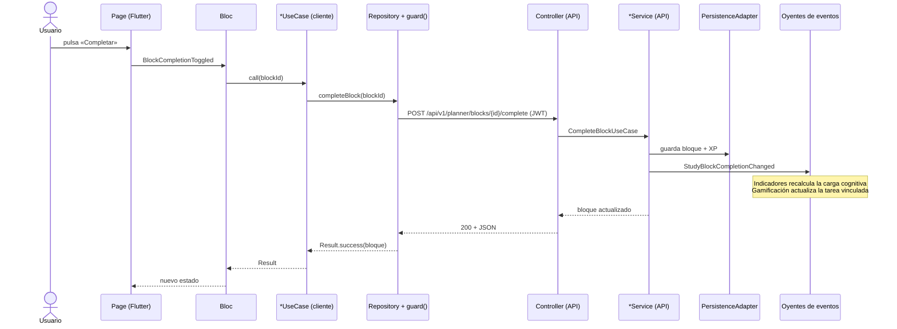

# Flujo de una acción de extremo a extremo

Ejemplo: el usuario marca un bloque de estudio del calendario como completado.

Si algo falla en la API, la respuesta es un Problem Details con `code` y el cliente muestra su propio texto (`error_pipeline.md`).
