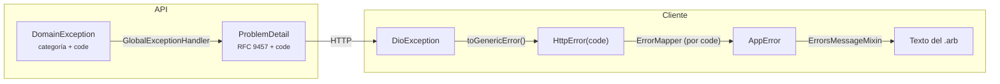

# Cadena de errores

- **API:** la categoría de la excepción decide el estado (404 no encontrado o ajeno, 409 conflicto, 422 regla de negocio, 400 validación, 401/403, 503 servicio externo). Errores inesperados: 500 `INTERNAL_ERROR`, sin detalles internos.
- **Cliente:** los repositorios no usan `try/catch`; `RepositoryErrorHandler.guard()` captura y traduce. Los `code` transversales tienen variante propia en `AppError`; los de negocio llegan como `AppError.business(code)` y cada módulo los traduce en `presentation/l10n/error_messages/<modulo>_error_messages.dart` (ADR 0006).
- **Sin conexión:** `NETWORK_UNAVAILABLE`, generado en el propio cliente.
- **Sesión caducada:** el interceptor de Dio renueva el token una vez; si no puede, borra la sesión y la app vuelve al login.

Catálogo completo: `../03-api/errors.md`.
