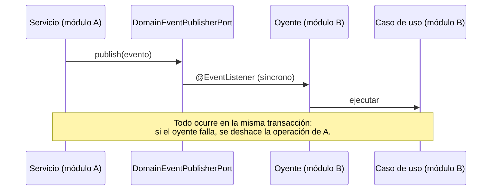

# Eventos de dominio

> **Qué es:** los hechos que un módulo publica para que otros reaccionen. Sustituyen a los triggers que acoplaban tablas de módulos distintos.

## Cómo funcionan

Reglas:

1. El evento es un `record` inmutable en `domain/event/<modulo>/` que implementa `DomainEvent`.
2. Se publica **después** de guardar el cambio, desde el servicio de aplicación.
3. El oyente vive en `infrastructure/adapter/input/event/<modulo>/` y solo traduce el evento a una llamada a un caso de uso de su módulo (retos e insignias comparten `event/gamification/`). `ArchitectureTest.inputAdaptersOnlyTalkToUseCases` impide que dependa de servicios concretos o de puertos de salida.
4. Los oyentes son **idempotentes**: solo actúan si el estado cambia. Así se evitan los bucles entre eventos bidireccionales (entrega ⇄ reto).

## Catálogo

| Evento | Publica | Escucha | Reacción |
|---|---|---|---|
| `UserRegistered` | Núcleo | Indicadores, Notificaciones | Crear estado cognitivo inicial y preferencias de notificación |
| `UserPrivacyChanged` | Núcleo | Entrenamiento, Gamificación, Académico, Planificador | Al pasar a `PRIVATE`, rutinas, retos, apuntes y planes semanales pasan a privados |
| `LevelUp` | Gamificación (`ExperienceService`) | Notificaciones | Aviso `MILESTONE` «has subido de nivel» (uno por nivel, clave `level:<n>`) |
| `DeadlineCompletionChanged` | Planificador | Gamificación | Completar o descompletar retos y tareas vinculados (con su XP). También se publica con `completed=false` al **borrar** una entrega completada. Con `completed=true`, evaluar insignias |
| `ChallengeLinkCompletionChanged` | Gamificación | Planificador | Marcar la entrega o examen vinculado |
| `StudyBlockCompletionChanged` | Planificador | Indicadores, Gamificación | Coste cognitivo del bloque; progreso de la tarea de reto vinculada; con `completed=true`, evaluar insignias |
| `SportBlockCompletionChanged` | Planificador (bloque de deporte sin rutina: al marcarlo, desmarcarlo o borrarlo hecho) | Indicadores | Registra o retira la carga física del bloque (esfuerzo × minutos; esfuerzo 5 si no se indica) y recalcula el ACWR |
| `ReviewAbandoned` | Académico (quitar un material del repaso) | Planificador | Borra los bloques de repaso pendientes de ese material; el material queda «abandonado» con su historial |
| `FocusSessionCompleted` | Planificador (Pomodoro) | Indicadores, Gamificación | Recalcular la carga cognitiva de hoy; evaluar insignias y racha (el día cuenta como activo). La XP (con tope diario) la da el propio planificador |
| `TrainingSessionCompletionChanged` | Entrenamiento | Indicadores, Gamificación, Planificador | Registrar o borrar la carga física y recalcular el ACWR; recontar los retos de fitness por sesiones (ADR 0009) y, al completar, evaluar insignias; el bloque de deporte del mismo día de rutina sigue el estado de la sesión (sin XP de bloque) |
| `CheckInSubmitted` | Entrenamiento | Gamificación, Notificaciones | Evaluar insignias y racha; si el check-in pide adaptar el entrenamiento, aviso `FATIGUE_ALERT` (uno al día) |
| `OvertrainingDetected` | Indicadores | Notificaciones | El ACWR acaba de entrar en sobreentrenamiento: aviso `FATIGUE_ALERT` (uno al día) |
| `ChallengeCompleted` | Gamificación | Social, Gamificación, Notificaciones | Publicación automática «reto completado» (sin duplicar si se recompleta); evaluar insignias; aviso `MILESTONE` (uno por reto, clave `challenge:<id>`: dos retos con el mismo título avisan los dos) |
| `BadgeEarned` | Gamificación | Social, Notificaciones | Publicación automática «insignia desbloqueada»; aviso `MILESTONE` (uno por insignia, clave `badge:<id>`) |
| `TestSessionCompleted` | Académico | Indicadores, Gamificación | Recalcular la carga cognitiva (el test cuenta como repaso, máx. 60 min); evaluar insignias |
| `ReviewCompleted` | Académico | Planificador, Indicadores, Gamificación | Completar el bloque de repaso pendiente de hoy o atrasado del material (sin XP de bloque: la da el repaso); recalcular la carga cognitiva; evaluar insignias. Se publica antes de `ReviewScheduled` |
| `ReviewScheduled` | Académico | Planificador | Mover el bloque de repaso pendiente del material a la siguiente fecha SM-2 o, si no hay, crearlo (no fijo) |
| `SubjectDeleted` | Académico | Planificador | Se publica **antes** del borrado físico (los bloques caen en cascada): el planificador borra los bloques de la asignatura restando su XP y publicando `StudyBlockCompletionChanged` |
| `TeachingGuideImportRequested` | Académico (importar plan docente) | Académico | **Asíncrono** (`@Async` + `@TransactionalEventListener`, tras confirmar la transacción, en el ejecutor `aiTaskExecutor` de 2 hilos): analizar el PDF con la IA y guardar el resultado o el `code` del error. Única excepción a la regla de oyentes síncronos, porque la IA puede tardar más de un minuto. Un análisis colgado más de 5 min cuenta como fallido |
| `TeachingGuideApplied` | Académico (aplicar plan docente) | Planificador | Crear las pruebas con fecha de la modalidad activa como entregas o exámenes (examen → dificultad alta), sin duplicar las que ya existan con el mismo título el mismo día |
| `UserDataErased` | Administración (RGPD) | — (para cachés o datos externos) | Datos de un usuario vaciados, anonimizados o eliminados |

Un módulo puede añadir eventos propios en su paquete; se registran aquí en el mismo cambio.

## Experiencia sin duplicados

Cuando la misma actividad aparece en dos módulos, la XP la da solo el módulo dueño de la actividad real:

| Actividad | Da la XP | No da XP |
|---|---|---|
| Sesión de entrenamiento de un día de rutina | Entrenamiento (sesión) | Su bloque de deporte (`dia_rutina_id`) |
| Repaso SM-2 de un material | Académico (repaso que tocaba: fecha vencida o primer repaso) | Su bloque de repaso (`material_estudio_id`) |
| Pomodoro dentro de un bloque | Planificador: el bloque y el Pomodoro (5 XP/ciclo, tope 20 XP/día; la respuesta lleva `xpStatus` = `AWARDED`, `DAILY_CAP_REACHED` o `NOT_ELIGIBLE`, calculado por `FocusRewards.evaluate`) | — (el Pomodoro es la mitad que un bloque de 30 min por eso) |
| Objetivo semanal de horas de estudio | Planificador (150 XP; se retiran si la semana vuelve a quedar por debajo) | — |

## Definición única de «actividad de estudio»

`ActivityType` del planificador es la única fuente; los demás módulos la usan por sus códigos (`ActivityType.codesWhere`, `isCognitiveCode`, `countsAsStudyCode`):

* **Cognitiva** (`isCognitive`): estudio, clase, repaso, examen, entrega. Carga cognitiva y kcal de estudio (Indicadores, inicio).
* **Tiempo de estudio** (`countsAsStudy`): estudio y repaso. Carga académica semanal y su objetivo de horas (que suma también la concentración del Pomodoro fuera de un bloque completado, `FocusSession.focusMinutesOutside`), rachas de estudio, insignia `bloques_estudio` y contexto académico del entrenamiento. Clases, exámenes y entregas quedan fuera: la clase es asistencia y exámenes y entregas se cuentan aparte como evaluaciones de la semana.
* **Prácticas sin bloque** (Pomodoro, tests, repasos SM-2): cuentan como actividad cognitiva en todo lo que muestra Indicadores e Inicio con la misma lista, `StudyActivity.of` (bloques cognitivos completados + `PracticeSessions.countable`), expuesta como `GetStudyActivityUseCase(from, to)`: carga cognitiva, minutos y kcal de estudio de hoy (`CognitiveStateService`) y minutos de estudio de la semana (`DashboardService`). Un Pomodoro hecho dentro de un bloque ya completado y un repaso SM-2 cuyo bloque de repaso se completó no se cuentan dos veces.
* **Progreso de un reto en Inicio**: `DashboardService` usa `ListMyChallengesUseCase` y `ActiveChallenge.of`, así que sigue el mismo criterio que `Challenge.progress()`, incluido el de sesiones de entrenamiento (ADR 0009). La respuesta de un reto lleva `tracksTrainingSessions` (`Challenge.tracksTrainingSessions()`) para que el cliente no repita la regla.
