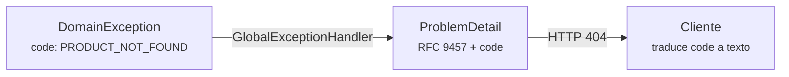

# Perfil: Spring Boot (hexagonal)

> Traducción del núcleo (`../core.md`) a Spring Boot con puertos y adaptadores.
> Revisión de la plantilla anterior: ver «Cambios respecto a la versión anterior» al final.

| Campo | Valor |
|---|---|
| **Tipo** | Backend (API HTTP) |
| **Tecnologías** | Java, Spring Boot (Web MVC, Data JPA), springdoc-openapi, ArchUnit. Versiones exactas en `docs/04-guides/onboarding.md` |
| **Estado** | Aprobado |
| **ADR de adopción** | `docs/02-adr/0003_spring_boot_hexagonal_ports_adapters.md` |

---

## 1. Mapeo de roles

| Rol del núcleo | En este perfil |
|---|---|
| Modelo de dominio | `domain/model/` (Java puro) |
| Error de dominio | `domain/exception/` (`DomainException` con `code`) |
| Contrato de repositorio | `domain/port/output/` (`*Port`) |
| Caso de uso | `application/port/input/` (contrato) + `application/service/` (implementación) |
| Adaptador de salida | `infrastructure/adapter/output/` (persistence, external) |
| Adaptador de entrada | `infrastructure/adapter/input/rest/` (controllers + DTOs) |
| Coordinador de estado | No aplica (servidor) |
| Traductor de errores | `infrastructure/adapter/input/rest/error/GlobalExceptionHandler` |
| Raíz de composición | `infrastructure/config/BeanConfiguration` |
| Verificador de arquitectura | `src/test/.../architecture/ArchitectureTest` (ArchUnit) |

```text
src/main/java/com/empresa/app/
├── Application.java
├── domain/                          # Java puro: 0 imports de Spring o JPA
│   ├── model/                       # Product.java …
│   ├── exception/                   # DomainException + específicas con code
│   └── port/output/                 # ProductRepositoryPort …
├── application/                     # Sin anotaciones de Spring
│   ├── port/input/<feature>/        # GetProductsUseCase …
│   └── service/<feature>/           # ProductService implements …UseCase
└── infrastructure/
    ├── adapter/
    │   ├── input/rest/
    │   │   ├── error/GlobalExceptionHandler.java
    │   │   └── <feature>/{Controller, dto/}
    │   └── output/
    │       ├── persistence/{entity, repository, mapper, adapter}/
    │       └── external/
    └── config/{BeanConfiguration, SecurityConfig}.java

src/test/java/com/empresa/app/
├── architecture/ArchitectureTest.java   # Regla de dependencia
├── application/service/                 # Unit tests con new + mocks de puertos
└── infrastructure/adapter/              # Tests de integración de adaptadores
```

## 2. Composición

- `domain` y `application` **no llevan anotaciones de Spring**.
- Los casos de uso se registran en `BeanConfiguration`, contra su contrato:

```java
@Configuration
public class BeanConfiguration {

    @Bean
    public GetProductsUseCase getProductsUseCase(ProductRepositoryPort productRepositoryPort) {
        return new ProductService(productRepositoryPort);
    }
}
```

- Los adaptadores de infraestructura sí pueden usar `@Component`, `@Repository` y `@RestController`.

## 3. Errores



### Errores de dominio con `code`

El dominio no sabe nada de HTTP: solo define el `code`.

```java
// domain/exception/DomainException.java
public abstract class DomainException extends RuntimeException {

    private final String code;

    protected DomainException(String code, String message) {
        super(message);
        this.code = code;
    }

    public String code() {
        return code;
    }
}

// domain/exception/ProductNotFoundException.java
public class ProductNotFoundException extends DomainException {
    public ProductNotFoundException(Long id) {
        super("PRODUCT_NOT_FOUND", "Product " + id + " not found");
    }
}

// domain/exception/InvalidProductPriceException.java
public class InvalidProductPriceException extends DomainException {
    public InvalidProductPriceException() {
        super("INVALID_PRODUCT_PRICE", "Price must be zero or positive");
    }
}
```

Las validaciones del modelo lanzan errores de dominio, no `IllegalArgumentException`:

```java
if (price == null || price.compareTo(BigDecimal.ZERO) < 0) {
    throw new InvalidProductPriceException();
}
```

### Traducción a RFC 9457

La relación `code` → estado HTTP vive en infraestructura, no en el dominio:

```java
// infrastructure/adapter/input/rest/error/GlobalExceptionHandler.java
@RestControllerAdvice
public class GlobalExceptionHandler extends ResponseEntityExceptionHandler {

    private static final Map<String, HttpStatus> STATUS_BY_CODE = Map.of(
            "PRODUCT_NOT_FOUND", HttpStatus.NOT_FOUND,
            "INVALID_PRODUCT_PRICE", HttpStatus.BAD_REQUEST
    );

    @ExceptionHandler(DomainException.class)
    public ProblemDetail handleDomain(DomainException ex) {
        HttpStatus status = STATUS_BY_CODE.getOrDefault(ex.code(), HttpStatus.UNPROCESSABLE_ENTITY);
        ProblemDetail problem = ProblemDetail.forStatusAndDetail(status, ex.getMessage());
        problem.setProperty("code", ex.code());
        return problem;
    }

    @ExceptionHandler(Exception.class)
    public ProblemDetail handleUnexpected(Exception ex) {
        // Registrar ex en el log; nunca exponer detalles internos al cliente.
        ProblemDetail problem = ProblemDetail.forStatus(HttpStatus.INTERNAL_SERVER_ERROR);
        problem.setProperty("code", "INTERNAL_ERROR");
        return problem;
    }
}
```

Al extender `ResponseEntityExceptionHandler`, los errores propios de Spring MVC (validación, método no permitido…) también salen en formato RFC 9457. Para que tengan `code`, sobrescribe sus métodos o añade la propiedad en un `@ExceptionHandler` específico.

- Las **respuestas de éxito** devuelven el DTO directamente: `ResponseEntity<List<ProductResponse>>`. No hay `ApiResponse<T>`.
- Cada `code` nuevo se añade a `docs/03-api/errors.md` y a `STATUS_BY_CODE` en el mismo PR.

## 4. Verificación

Dependencia de test: `com.tngtech.archunit:archunit-junit5`.

```java
// src/test/java/com/empresa/app/architecture/ArchitectureTest.java
@AnalyzeClasses(packages = "com.empresa.app", importOptions = ImportOption.DoNotIncludeTests.class)
class ArchitectureTest {

    @ArchTest
    static final ArchRule domainIsPure = noClasses()
            .that().resideInAPackage("..domain..")
            .should().dependOnClassesThat().resideInAnyPackage(
                    "org.springframework..", "jakarta.persistence..",
                    "..application..", "..infrastructure..");

    @ArchTest
    static final ArchRule applicationHasNoFramework = noClasses()
            .that().resideInAPackage("..application..")
            .should().dependOnClassesThat().resideInAnyPackage(
                    "org.springframework..", "jakarta.persistence..", "..infrastructure..");

    @ArchTest
    static final ArchRule jpaEntitiesStayInPersistence = noClasses()
            .that().resideOutsideOfPackage("..adapter.output.persistence..")
            .should().dependOnClassesThat().resideInAPackage("..persistence.entity..");
}
```

## 5. Comandos

| Acción | Maven | Gradle |
|---|---|---|
| Tests (incluye arquitectura) | `./mvnw test` | `./gradlew test` |
| Ejecutar en local | `./mvnw spring-boot:run` | `./gradlew bootRun` |
| Especificación OpenAPI | Con la app arrancada: `GET /v3/api-docs.yaml` → `docs/03-api/openapi.yaml` | Igual |

La especificación OpenAPI se **genera** con springdoc-openapi (`springdoc-openapi-starter-webmvc-ui`, en la versión compatible con vuestro Spring Boot). Nunca se escribe a mano.

---

## Convenciones propias del perfil

1. **Las `@Entity` nunca salen del adaptador de persistencia.** Se mapean a modelo de dominio en `mapper/`, y el controller mapea a DTO.
2. **DTOs como `record`** dentro de `rest/<feature>/dto/`.
3. **Casos de uso granulares:** un contrato por intención. Un `Service` puede implementar varios contratos de la misma feature.
4. **Los servicios se prueban con `new`** y mocks de los puertos, sin levantar el contexto de Spring.

## Diferencias respecto al núcleo

- Los **casos de uso tienen su propia capa** (`application/`), separada del dominio.
- **No hay coordinador de estado**: el controller llama al caso de uso y responde.
- Los **errores de dominio son excepciones** con `code`, no `Result`. Es una asimetría consciente con los clientes: Java las gestiona de forma nativa y el `GlobalExceptionHandler` las centraliza.

## Etiquetas para diagramas y shorts

| Rol | Etiqueta en este stack |
|---|---|
| Adaptador de entrada | `*Controller` |
| Caso de uso | `*UseCase` → `*Service` |
| Contrato de repositorio | `*RepositoryPort` |
| Adaptador de salida | `*PersistenceAdapter` → Spring Data → BD |
| Traductor de errores | `GlobalExceptionHandler` → `ProblemDetail` |

---

## Cambios respecto a la versión anterior

1. **Tabla de mapeo con Flutter sustituida** por el mapeo de roles del núcleo. La anterior usaba nombres que no existen en la plantilla Flutter (`domain/entities/`, `data/models/`, `presentation/features/`…).
2. **Validaciones del modelo** con excepciones de dominio (`InvalidProductPriceException`) en lugar de `IllegalArgumentException`.
3. **`ApiResponse.java` eliminado.** Errores con `ProblemDetail` (RFC 9457) + `code`; éxito con el DTO directo.
4. **Regla de aislamiento automatizada** con ArchUnit; antes era un checklist manual.
5. **OpenAPI generado** con springdoc en lugar de escrito a mano.
6. **Estructura de tests** añadida.
