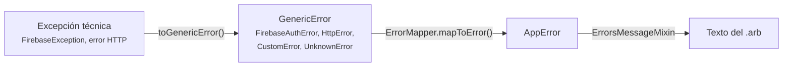

# Perfil: Flutter + BLoC

> Traducción del núcleo (`../core.md`) a Flutter. Basado en la **plantilla corporativa**, que es obligatoria para frontends Flutter.
> Única adición respecto a la plantilla: `data/errors/http_errors/`, necesaria cuando el backend es una API HTTP.

| Campo | Valor |
|---|---|
| **Tipo** | Frontend (cliente móvil / web) |
| **Tecnologías** | Flutter, Dart, `get_it`, `flutter_bloc`, `go_router`, `freezed`, `build_runner`. Firebase opcional |
| **Estado** | Obligatorio en la empresa para frontends Flutter |
| **ADR de adopción** | `docs/02-adr/0002_flutter_bloc_state_management.md` |

---

## 1. Mapeo de roles

| Rol del núcleo | En este perfil |
|---|---|
| Modelo de dominio | `domain/models/` (con `@freezed`) y `domain/enums/` |
| Error de dominio | `domain/errors/app_error.dart` (`AppError`, sellado) |
| Contrato de repositorio | `domain/repositories/` (`*RepositoryContract`) |
| Caso de uso | `domain/use_cases/` (`Contract` + implementación) |
| Adaptador de salida | `data/repository/` + `data/remote_data_source/` |
| Adaptador de entrada | `presentation/screens/**/page/` |
| Coordinador de estado | `presentation/screens/**/bloc/` |
| Traductor de errores | `data/errors/` (técnico → `AppError`) + `presentation/mixins/errors_message_mixin.dart` (`AppError` → texto) |
| Raíz de composición | `app/di/app_di.dart` + `di/` de cada capa |
| Verificador de arquitectura | `test/architecture/dependency_rule_test.dart` |

```text
lib/
├── main.dart                     # init (Firebase opcional) → appInitDi() → runApp
├── routes.dart                   # go_router
├── app/
│   ├── di/app_di.dart            # Raíz de composición
│   └── validators/
├── data/                         # Adaptadores de salida
│   ├── di/data_di.dart
│   ├── remote_data_source/
│   ├── repository/               # Implementan los contratos con guard()
│   └── errors/
│       ├── generic_error.dart
│       ├── firebase_errors/      # Si se usa Firebase
│       ├── http_errors/          # ← NUEVO: si el backend es HTTP (RFC 9457)
│       ├── custom_error.dart
│       ├── unknown_error.dart
│       ├── error_extension.dart  # toGenericError()
│       ├── error_mapper.dart     # GenericError → AppError
│       └── repository_error_handler.dart  # guard() / guardStream()
├── domain/                       # Dominio + casos de uso
│   ├── di/domain_di.dart
│   ├── enums/
│   ├── errors/app_error.dart
│   ├── models/                   # incl. result/ (Result<T, E>)
│   ├── repositories/             # Contratos
│   └── use_cases/
└── presentation/                 # Entrada + estado
    ├── di/presentation_di.dart
    ├── extensions/  l10n/  mixins/  theme/  widgets/
    └── screens/<zona>/<pantalla>/{bloc,page}/
```

## 2. Composición

- Cada capa tiene su `di/` y registra sus piezas **contra su contrato** con `get_it`.
- `appInitDi()` llama en orden a `data` → `domain` → `presentation`, porque cada capa resuelve lo que registró la anterior.
- Los blocs se registran como `factory` (una instancia por pantalla). Repositorios, data sources y casos de uso, como `lazySingleton`.

## 3. Errores

Las tres traducciones del núcleo, con nombres concretos:



Los repositorios **nunca** usan `try/catch`: envuelven la llamada en `RepositoryErrorHandler.guard()` y devuelven `Result<T, AppError>`.

### Consumir RFC 9457 (backend HTTP)

`http_errors/` sigue el mismo patrón que `firebase_errors/`. Boceto orientativo; adáptalo a la firma real de `GenericError`:

```dart
// data/errors/http_errors/http_error.dart
class HttpError implements GenericError {
  const HttpError({required this.status, required this.code, this.detail});

  /// Construye el error a partir de un cuerpo application/problem+json.
  factory HttpError.fromProblemJson(int status, Map<String, dynamic> json) {
    return HttpError(
      status: status,
      code: json['code'] as String? ?? 'UNKNOWN',
      detail: json['detail'] as String?, // solo para logs, nunca para la UI
    );
  }

  /// Sin respuesta del servidor (sin conexión, timeout).
  const HttpError.network()
      : status = 0,
        code = 'NETWORK_UNAVAILABLE',
        detail = null;

  final int status;
  final String code;
  final String? detail;
}
```

- `toGenericError()` convierte la excepción del cliente HTTP que uséis (`dio` o `http`) en `HttpError`.
- `ErrorMapper` traduce **por `code`**, no por `status`: `PRODUCT_NOT_FOUND` → la variante de `AppError` correspondiente. Un `code` desconocido se traduce al `AppError` genérico.
- Cada `code` del catálogo `docs/03-api/errors.md` tiene su texto en `app_es.arb`.

## 4. Verificación

Test sin dependencias externas que revisa los imports de cada capa. Se ejecuta con `flutter test`:

```dart
// test/architecture/dependency_rule_test.dart
import 'dart:io';

import 'package:flutter_test/flutter_test.dart';

/// Imports prohibidos por carpeta (regla de dependencia del núcleo).
const _rules = <String, List<String>>{
  'lib/domain': [
    '/data/',
    '/presentation/',
    'package:firebase_',
    'package:dio/',
    'package:http/',
    'package:flutter_bloc/',
  ],
  'lib/data': ['/presentation/'],
  'lib/presentation': ['/data/'],
};

void main() {
  for (final rule in _rules.entries) {
    test('${rule.key} respeta la regla de dependencia', () {
      final violations = <String>[];
      final files = Directory(rule.key)
          .listSync(recursive: true)
          .whereType<File>()
          .where((f) =>
              f.path.endsWith('.dart') &&
              !f.path.endsWith('.g.dart') &&
              !f.path.endsWith('.freezed.dart'));

      for (final file in files) {
        final imports =
            file.readAsLinesSync().where((l) => l.trimLeft().startsWith('import '));
        for (final line in imports) {
          for (final banned in rule.value) {
            if (line.contains(banned)) violations.add('${file.path} → $line');
          }
        }
      }

      expect(violations, isEmpty, reason: violations.join('\n'));
    });
  }
}
```

`app/` queda fuera a propósito: es la raíz de composición y puede conocer todas las capas.

## 5. Comandos

| Acción | Comando |
|---|---|
| Instalar dependencias | `flutter pub get` |
| Generar código | `dart run build_runner build --delete-conflicting-outputs` |
| Generar traducciones | `flutter gen-l10n` |
| Tests (incluye arquitectura) | `flutter test` |
| Análisis estático | `flutter analyze` |
| Ejecutar en local | `flutter run` |

---

## Convenciones propias del perfil

1. **Cada pantalla = `bloc/` + `page/`.** El bloc en tres archivos: `*_bloc.dart` (con `part`), `*_event.dart` y `*_state.dart` (con `@freezed`).
2. **`Result<T, E>`** para éxito o error; no se lanzan excepciones fuera de `data/`.
3. **Barrels** (`pages.dart`, `widgets.dart`) para agrupar exports.
4. **Widgets reutilizables** en `widgets/`. Solo parametrizan lo que varía; lo fijo va dentro.
5. **Textos** siempre en `.arb`, accesibles con `context.localizations`.

## Diferencias respecto al núcleo

- Los **casos de uso viven dentro de `domain/`** (no hay capa de aplicación separada).
- El **coordinador de estado es el bloc**.
- La **raíz de composición está repartida**: cada capa registra lo suyo y `app_di.dart` las orquesta.

## Etiquetas para diagramas y shorts

| Rol | Etiqueta en este stack |
|---|---|
| Adaptador de entrada | Page |
| Coordinador de estado | Bloc |
| Caso de uso | `*UseCase` |
| Contrato de repositorio | `*RepositoryContract` |
| Adaptador de salida | Repository + `guard()` → RemoteDataSource |
| Traductor de errores | `toGenericError()` → `ErrorMapper` → `ErrorsMessageMixin` |
