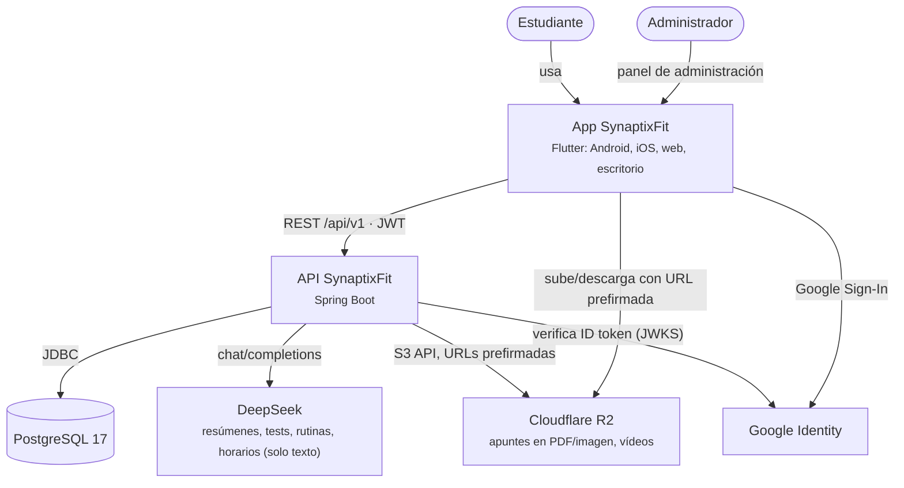

# Contexto del sistema

> Vista C4 de niveles 1 y 2: quién usa SynaptixFit y de qué piezas se compone.

- El cliente **nunca** habla con la base de datos ni con la IA. Con R2 solo usa URLs firmadas por la API y de corta duración.
- La API es la única que conoce secretos (JWT, DeepSeek, R2).
