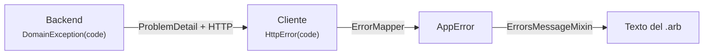

# Catálogo de códigos de error

> **Qué es:** el contrato de errores entre el backend y la app. Cada fila une el backend (que emite el `code`), el cliente (que lo traduce) y el texto que ve el usuario.
> **Regla:** un `code` nuevo se añade aquí **en el mismo cambio** que lo introduce, en backend y cliente.
> Formato de transporte: RFC 9457 con el campo de extensión `code` (ver `../01-architecture/error_pipeline.md`).

## Cómo se lee una fila



## Reglas del catálogo

1. **Nombre:** `ENTIDAD_PROBLEMA` en `UPPER_SNAKE_CASE`, en inglés, con el prefijo del módulo.
2. **Un `code` es para siempre.** No se renombra ni se reutiliza con otro significado. Si deja de usarse, se marca como *obsoleto* y se mantiene la fila.
3. **El estado HTTP orienta, el `code` decide.** El cliente traduce siempre por `code`. Un `code` desconocido se traduce al error genérico (`UNKNOWN`), nunca rompe la app.
4. **El `detail` es para desarrolladores.** El usuario solo ve el texto de la columna «Texto (es)».
5. **Estado HTTP:** lo deriva la categoría de la excepción de dominio (ADR 0006): no encontrado o ajeno → 404, conflicto → 409, validación → 400, autenticación → 401, prohibido → 403, regla de negocio → 422, servicio externo → 503 (cuota de IA → 429).
6. **Cliente:** los códigos transversales tienen variante propia de `AppError`; los de negocio llegan como `AppError.business('CODE')` y se traducen en `presentation/l10n/error_messages/<modulo>_error_messages.dart`.

---

## Transversales

| `code` | HTTP | Origen | Significado | `AppError` | Clave `.arb` | Texto (es) |
|---|---|---|---|---|---|---|
| `INTERNAL_ERROR` | 500 | Backend | Error inesperado del servidor | `AppError.server()` | `errorServer` | Algo ha fallado en el servidor. Inténtalo de nuevo en unos minutos. |
| `VALIDATION_ERROR` | 400 | Backend | Datos de entrada inválidos (ver `fields`) | `AppError.validation()` | `errorValidation` | Revisa los datos marcados. |
| `UNAUTHORIZED` | 401 | Backend | Sesión ausente o caducada | `AppError.unauthorized()` | `errorUnauthorized` | Tu sesión ha caducado. Vuelve a iniciar sesión. |
| `FORBIDDEN` | 403 | Backend | Sin permisos para la acción | `AppError.forbidden()` | `errorForbidden` | No tienes permiso para hacer esto. |
| `NOT_FOUND` | 404 | Backend | Ruta inexistente | `AppError.notFound()` | `errorNotFound` | No hemos encontrado lo que buscas. |
| `CONFLICT` | 409 | Backend | Choque con datos existentes (restricción única, concurrencia) | `AppError.conflict()` | `errorConflict` | Esto choca con datos que ya existen. |
| `METHOD_NOT_ALLOWED` | 405 | Backend | Método HTTP no soportado (error de programación) | `AppError.unknown()` | `errorUnknown` | Ha ocurrido un error inesperado. |
| `BAD_REQUEST` | 4xx | Backend | Otra petición inválida del framework | `AppError.validation()` | `errorValidation` | Revisa los datos marcados. |
| `NETWORK_UNAVAILABLE` | — | Cliente | Sin respuesta del servidor (sin conexión, timeout) | `AppError.network()` | `errorNetwork` | No hay conexión. Comprueba tu red e inténtalo de nuevo. |
| `UNKNOWN` | — | Cliente | `code` no reconocido o error no clasificado | `AppError.unknown()` | `errorUnknown` | Ha ocurrido un error inesperado. |
| `AI_UNAVAILABLE` | 503 | Backend | El proveedor de IA ha fallado o su respuesta no es válida | `AppError.business` | `errorAiUnavailable` | El asistente de IA no está disponible ahora mismo. Inténtalo más tarde. |
| `AI_QUOTA_EXCEEDED` | 429 | Backend | Cuota del proveedor de IA agotada | `AppError.business` | `errorAiQuotaExceeded` | Se ha alcanzado el límite de uso de la IA. Inténtalo dentro de un rato. |
| `AI_ATTACHMENT_UNSUPPORTED` | 422 | Backend | La IA (DeepSeek, solo texto) no puede leer el adjunto: imagen o PDF escaneado sin texto | `AppError.business` | `errorAiAttachmentUnsupported` | La IA solo puede leer PDF con texto. Las imágenes y los PDF escaneados no se pueden analizar. |
| `STORAGE_UNAVAILABLE` | 503 | Backend | El almacenamiento de archivos no responde o no está configurado (sin endpoint o credenciales de R2) | `AppError.business` | `errorStorageUnavailable` | No se ha podido acceder a los archivos. Inténtalo de nuevo. |

### Extensión `fields` para `VALIDATION_ERROR`

```json
{
  "status": 400,
  "title": "Bad Request",
  "detail": "Validation failed",
  "code": "VALIDATION_ERROR",
  "fields": [ { "field": "email", "code": "INVALID_FORMAT" } ]
}
```

Códigos de campo: `REQUIRED`, `INVALID_LENGTH`, `OUT_OF_RANGE`, `INVALID_FORMAT`, `MUST_BE_POSITIVE_OR_ZERO`, `TOO_MANY_ITEMS`, `INVALID_RANGE`, `INVALID`.

---

## Autenticación y cuenta (núcleo)

| `code` | HTTP | Significado | Clave `.arb` | Texto (es) | Estado |
|---|---|---|---|---|---|
| `AUTH_INVALID_CREDENTIALS` | 401 | Email o contraseña incorrectos | `errorAuthInvalidCredentials` | Email o contraseña incorrectos. | Activo |
| `AUTH_INVALID_REFRESH_TOKEN` | 401 | Token de refresco inválido, caducado o revocado | `errorUnauthorized` | Tu sesión ha caducado. Vuelve a iniciar sesión. | Activo |
| `AUTH_INVALID_GOOGLE_TOKEN` | 401 | ID token de Google no verificable | `errorAuthGoogleFailed` | No se ha podido iniciar sesión con Google. | Activo |
| `AUTH_ACCOUNT_DISABLED` | 403 | Cuenta eliminada o desactivada | `errorAuthAccountDisabled` | Esta cuenta está desactivada. | Activo |
| `AUTH_EMAIL_ALREADY_REGISTERED` | 409 | Ya existe una cuenta con ese email | `errorAuthEmailAlreadyRegistered` | Ya existe una cuenta con ese email. | Activo |
| `AUTH_RESET_TOKEN_INVALID` | 400 | El enlace para restablecer la contraseña no existe, ya se usó o caducó | `errorAuthResetTokenInvalid` | Este enlace ya no sirve: caduca a los 30 minutos y solo se puede usar una vez. Pide otro. | Activo |
| `AUTH_WEAK_PASSWORD` | 400 | Contraseña fuera de la política (≥ 8, letras y números) | `errorAuthWeakPassword` | La contraseña debe tener al menos 8 caracteres, con letras y números. | Activo |
| `USER_NOT_FOUND` | 404 | El usuario no existe | `errorNotFound` | No hemos encontrado lo que buscas. | Activo |
| `GOOGLE_SIGN_IN_CANCELLED` | — (cliente) | El usuario cerró el diálogo de Google | `errorAuthGoogleCancelled` | Has cancelado el inicio de sesión con Google. | Activo |
| `GOOGLE_SIGN_IN_FAILED` | — (cliente) | Fallo del SDK de Google o sin ID token | `errorAuthGoogleFailed` | No se ha podido iniciar sesión con Google. | Activo |

<!-- Las secciones de cada módulo se añaden debajo. -->

## Administración y RGPD

| `code` | HTTP | Significado | Texto (es) | Estado |
|---|---|---|---|---|
| `ADMIN_USER_NOT_FOUND` | 404 | El usuario no existe | El usuario no existe. | Activo |
| `ADMIN_CANNOT_TARGET_SELF` | 422 | Acción no permitida sobre la propia cuenta (rol, shadowban, vaciar, anonimizar, eliminar) | No puedes aplicar esta acción a tu propia cuenta. | Activo |
| `ADMIN_EMAIL_ALREADY_IN_USE` | 409 | El email ya pertenece a otra cuenta | Ese email ya está en uso por otra cuenta. | Activo |
| `ADMIN_USER_DELETED` | 422 | La cuenta está anonimizada o desactivada (solo admite exportar o eliminar) | Esta cuenta está eliminada o anonimizada. | Activo |
| `ADMIN_INVALID_DATE_RANGE` | 400 | `from` no es anterior a `to` | La fecha de inicio debe ser anterior a la de fin. | Activo |
| `GDPR_CONFIRMATION_REQUIRED` | 400 | Falta la contraseña o la confirmación explícita de la baja | Confirma la baja con tu contraseña. | Activo |
| `GDPR_PASSWORD_MISMATCH` | 403 | Contraseña de confirmación incorrecta (403 para no confundirlo con sesión caducada) | La contraseña no es correcta. | Activo |
| `GDPR_LAST_ADMIN` | 422 | El último administrador activo no puede darse de baja | Eres el último administrador: nombra a otro antes de darte de baja. | Activo |

## Indicadores (neurofisiología, analítica e inicio)

| `code` | HTTP | Significado | Texto (es) | Estado |
|---|---|---|---|---|
| `INSIGHTS_INVALID_TIME_ZONE` | 400 | `tz` no es una zona IANA válida | La zona horaria indicada no es válida. | Activo |
| `ANALYTICS_INVALID_PERIOD` | 400 | `period` no es WEEKLY, MONTHLY ni QUARTERLY | El periodo seleccionado no es válido. | Activo |
| `ANALYTICS_INVALID_METRIC` | 400 | `metric` no es RPE ni MINUTES | La métrica seleccionada no es válida. | Activo |

## Social y notificaciones

| `code` | HTTP | Significado | Texto (es) | Estado |
|---|---|---|---|---|
| `POST_NOT_FOUND` | 404 | La publicación no existe o no es visible | Esta publicación ya no está disponible. | Activo |
| `POST_FORBIDDEN` | 403 | Editar o borrar una publicación ajena | Solo el autor puede modificar esta publicación. | Activo |
| `POST_ALREADY_SHARED` | 409 | Compartir otra vez la misma sesión en el muro | Ya lo habías compartido en el muro. | Activo |
| `POST_TYPE_NOT_ALLOWED` | 422 | Publicar a mano una publicación de tipo `ROUTINE` o `CHALLENGE` (no enlazaban ninguna rutina ni reto; las antiguas se siguen mostrando) | Ese tipo de publicación ya no se puede crear. | Activo |
| `COMMENT_NOT_FOUND` | 404 | El comentario no existe, está borrado o no es visible | Este comentario ya no está disponible. | Activo |
| `COMMENT_FORBIDDEN` | 403 | Editar o borrar un comentario ajeno | Solo el autor puede modificar este comentario. | Activo |
| `FRIENDSHIP_NOT_FOUND` | 404 | La relación no existe o no es tuya | No se encontró la solicitud o amistad. | Activo |
| `FRIENDSHIP_ALREADY_EXISTS` | 409 | Ya sois amigos o la solicitud ya está enviada | Ya enviaste una solicitud o ya sois amigos. | Activo |
| `FRIENDSHIP_SELF_TARGET` | 422 | Solicitarse o bloquearse a uno mismo | No puedes hacer esto contigo mismo. | Activo |
| `FRIENDSHIP_INVALID_STATE` | 422 | Transición de estado no válida | Esta solicitud ya no se puede gestionar. | Activo |
| `FRIENDSHIP_BLOCKED` | 422 | Tienes bloqueado a ese usuario | Desbloquea a este usuario antes de enviarle una solicitud. | Activo |
| `SOCIAL_USER_NOT_FOUND` | 404 | Usuario inexistente, eliminado, con shadowban o que te ha bloqueado | Usuario no encontrado. | Activo |
| `SOCIAL_CANNOT_REPORT_OWN_CONTENT` | 422 | Reportar contenido propio | No puedes reportar tu propio contenido. | Activo |
| `NOTIFICATION_NOT_FOUND` | 404 | La notificación no existe o es ajena | Esta notificación ya no existe. | Activo |
| `NOTIFICATION_WEEKLY_EMAIL_LINK_INVALID` | 404 | El enlace de confirmación o de baja del resumen semanal no existe o ya se usó | — (página web del backend) | Enlace no válido: gestiona el resumen en Ajustes › Notificaciones. | Activo |
| `NOTIFICATION_INVALID_QUIET_HOURS` | 400 | Solo una de las horas de silencio, o inicio igual a fin | Indica la hora de inicio y de fin del silencio (distintas). | Activo |

## Perfil y catálogo académico

| `code` | HTTP | Significado | Texto (es) | Estado |
|---|---|---|---|---|
| `PROFILE_WELLNESS_NOT_FOUND` | 404 | El usuario aún no tiene perfil de bienestar | Todavía no has completado tu perfil físico. | Activo |
| `PROFILE_ACADEMIC_NOT_FOUND` | 404 | El usuario aún no tiene perfil académico | Todavía no has configurado tu perfil académico. | Activo |
| `PROFILE_INVALID_CLASS_DATES` | 400 | Fin de clases anterior al inicio | La fecha de fin de clases no puede ser anterior a la de inicio. | Activo |
| `ENROLLMENT_CONSENT_REQUIRED` | 422 | Se intenta leer un documento de matrícula sin el permiso expreso del usuario | Necesitamos tu permiso para leer el documento. | Activo |
| `ENROLLMENT_FILE_INVALID` | 400 | El documento de matrícula está vacío, dañado, no es un PDF o pasa de 5 MB | Sube un PDF de 5 MB como máximo. | Activo |
| `ENROLLMENT_TOO_MANY_SUBJECTS` | 400 | Se piden más de 40 asignaturas al aplicar la matrícula | Has elegido demasiadas asignaturas de una vez. | Activo |
| `ENROLLMENT_NOTHING_FOUND` | 422 | No se ha encontrado ninguna asignatura matriculada en el documento | No hemos encontrado asignaturas en el documento. Comprueba que es la carta de pago o el resguardo de matrícula. | Activo |
| `PROFILE_ONBOARDING_WELLNESS_REQUIRED` | 422 | Cerrar el onboarding sin perfil de bienestar | Completa tu perfil físico antes de terminar. | Activo |
| `CATALOG_UNIVERSITY_NOT_FOUND` | 404 | La universidad no existe | No encontramos esa universidad. | Activo |
| `CATALOG_CENTER_NOT_FOUND` | 404 | El centro no existe | No encontramos ese centro. | Activo |
| `CATALOG_DEGREE_NOT_FOUND` | 404 | La carrera no existe | No encontramos esa carrera. | Activo |
| `CATALOG_SUBJECT_NOT_FOUND` | 404 | La asignatura del catálogo no existe | No encontramos esa asignatura. | Activo |

## Gamificación (retos, insignias y rachas)

| `code` | HTTP | Significado | Texto (es) | Estado |
|---|---|---|---|---|
| `CHALLENGE_NOT_FOUND` | 404 | Reto inexistente, ajeno o no visible | No encontramos este reto. | Activo |
| `MILESTONE_NOT_FOUND` | 404 | Tarea inexistente en ese reto | No encontramos esta tarea. | Activo |
| `CHALLENGE_SUBJECT_NOT_FOUND` | 404 | Asignatura inexistente o ajena | La asignatura seleccionada no existe. | Activo |
| `CHALLENGE_LINK_NOT_FOUND` | 404 | Entrega o examen vinculado inexistente o ajeno | El examen o la entrega vinculados no existen. | Activo |
| `MILESTONE_ATTACHMENT_NOT_FOUND` | 404 | Apunte o archivo adjunto inexistente o ajeno | El apunte o archivo adjunto no existe. | Activo |
| `CHALLENGE_TYPE_OUTSIDE_FOCUS` | 422 | El ámbito del reto (académico o físico) no está en el enfoque de uso de la persona | Ese tipo de reto no está activo en tu cuenta. Cámbialo en tu perfil si quieres usarlo. | Activo |
| `CHALLENGE_INVALID_DATES` | 400 | `endAt` no es posterior a `startAt` | La fecha de fin debe ser posterior a la de inicio. | Activo |
| `CHALLENGE_EXPIRED` | 422 | Completar, desmarcar, sumar progreso o editar las tareas de un reto cuya fecha de fin ya pasó (aunque esté completado) | Este reto ya terminó: no se puede seguir avanzando. | Activo |
| `CHALLENGE_NOT_STARTED` | 422 | Completar, desmarcar o registrar progreso antes de la fecha de inicio (ADR 0028) | Este reto aún no ha empezado: podrás avanzar desde su fecha de inicio. | Activo |
| `CHALLENGE_LINKED` | 422 | Completar, desmarcar o registrar progreso a mano en un reto sin tareas vinculado a una entrega o examen: lo completa esa entrega (ADR 0028) | Este reto se completa con su entrega o examen: márcalo como hecho en el planificador. | Activo |
| `MILESTONE_LINKED` | 422 | Marcar, desmarcar o registrar progreso a mano en una tarea vinculada a una entrega/examen o con bloques del calendario asignados (ADR 0028) | Esta tarea avanza con su entrega o sus bloques del calendario: márcalos como hechos en el planificador. | Activo |
| `CHALLENGE_LINK_OUTSIDE_PERIOD` | 422 | La entrega o examen vinculado (al reto o a una tarea) vence fuera del periodo del reto, por días (ADR 0028) | La entrega o el examen vence fuera de las fechas del reto. Amplía el reto o elige otro. | Activo |
| `MILESTONE_ATTACHMENT_CONFLICT` | 400 | Apunte y archivo a la vez | Una tarea solo puede tener un apunte o un archivo. | Activo |
| `CHALLENGE_TOO_MANY_MILESTONES` | 422 | Más de 12 tareas | Un reto puede tener como máximo 12 tareas. | Activo |
| `MILESTONE_WEIGHTS_INVALID` | 422 | Pesos que no suman 100 o incompletos | Los pesos de las tareas deben sumar 100 %. | Retirado (ADR 0028: el peso lo deriva el servidor de la dificultad; `weight` se ignora) |
| `MILESTONE_DEPENDENCY_INVALID` | 422 | Dependencia inexistente, propia, duplicada, cíclica o X_OF_Y imposible | Las dependencias entre tareas no son válidas. | Activo |
| `MILESTONE_LOCKED` | 422 | Tarea bloqueada por sus dependencias | Completa antes las tareas de las que depende. | Activo |
| `MILESTONE_ORDER_INVALID` | 422 | Orden que no incluye todas las tareas una vez | El nuevo orden no es válido. | Activo |
| `CHALLENGE_PROGRESS_MILESTONE_REQUIRED` | 422 | Progreso sin tarea en un reto con tareas | Elige la tarea en la que registrar el progreso. | Activo |
| `MILESTONE_ALREADY_COMPLETED` | 409 | Progreso sobre una tarea completada | Esta tarea ya está completada. | Activo |
| `CHALLENGE_ALREADY_COMPLETED` | 409 | Progreso sobre un reto completado | Este reto ya está completado. | Activo |
| `BADGE_NOT_FOUND` | 404 | Insignia inexistente o no obtenida | No encontramos esta insignia. | Activo |
| `STREAK_INVALID_ZONE` | 400 | `zone` no es IANA | Zona horaria no válida. | Activo |

## Planificador

| `code` | HTTP | Significado | Texto (es) | Estado |
|---|---|---|---|---|
| `BLOCK_NOT_FOUND` | 404 | El bloque no existe o es de otro usuario | No encontramos ese bloque. | Activo |
| `BLOCK_IN_PAST` | 422 | Crear, mover o redimensionar hacia el pasado | No puedes colocar bloques en una hora o fecha pasada. | Activo |
| `BLOCK_LOCKED` | 422 | Bloque fijo o inamovible | Este bloque es fijo y no se puede mover. | Activo |
| `BLOCK_IN_FUTURE` | 422 | Marcar como hecho un bloque que aún no ha empezado | Este bloque aún no ha empezado: márcalo cuando lo hagas. | Activo |
| `BLOCK_NO_FREE_SLOT` | 409 | Reprogramar sin hueco libre de su duración (8:00-22:00, próximos 7 días) | No hay un hueco libre en los próximos días. Muévelo a mano. | Activo |
| `BLOCK_COMPLETED_LOCKED` | 422 | Cambiar horario o tipo de un bloque completado | Desmarca el bloque como completado antes de cambiarlo. | Activo |
| `BLOCK_ROUTINE_LINKED` | 409 | Marcar o desmarcar a mano un bloque de deporte enlazado a un día de rutina (sigue a su sesión) | Este bloque sigue a su sesión de la rutina: entrénalo o apúntalo desde la rutina. | Activo |
| `BLOCK_INVALID_TIME_RANGE` | 400 | Fin ≤ inicio o menos de 30 minutos | El bloque debe durar al menos 30 minutos. | Activo |
| `BLOCK_OUTSIDE_CHALLENGE_PERIOD` | 422 | Crear, editar o mover un bloque de un reto (o de una tarea de reto) fuera del periodo de ese reto, por días (ADR 0028) | El bloque queda fuera de las fechas de su reto. Muévelo o amplía el reto. | Activo |
| `DEADLINE_NOT_FOUND` | 404 | La entrega no existe o es de otro usuario | No encontramos esa entrega o examen. | Activo |
| `PLAN_NOT_FOUND` | 404 | El plan no existe o es de otro usuario | No encontramos ese plan. | Activo |
| `PLANNER_SUBJECT_NOT_FOUND` | 404 | Asignatura inexistente o ajena | No encontramos esa asignatura. | Activo |
| `PLANNER_ROUTINE_NOT_FOUND` | 404 | Rutina, semana o día inexistente o ajeno | No encontramos esa rutina. | Activo |
| `PLANNER_CHALLENGE_NOT_FOUND` | 404 | Reto o tarea vinculados inexistentes o ajenos, o tarea que no es del reto indicado | No encontramos ese reto. | Activo |
| `PLANNER_ROUTINE_EMPTY` | 422 | La rutina no tiene días | La rutina no tiene días que añadir al calendario. | Activo |
| `PLANNER_RANGE_TOO_LARGE` | 400 | Rango de fechas inválido o demasiado grande | El rango de fechas no es válido. | Activo |
| `PLANNER_ICS_URL_MISSING` | 422 | Sin URL ICS en la petición ni en la asignatura (o calendario general sin URL) | Añade la URL del calendario de la asignatura. | Activo |
| `PLANNER_PAST_ACTIVITY_OUT_OF_RANGE` | 422 | La actividad pasada aún no ha terminado o es de hace más de 7 días | `plannerErrorPastActivityOutOfRange` | Solo puedes apuntar actividades ya terminadas de los últimos 7 días. | Activo |
| `PLANNER_PAST_ACTIVITY_TYPE_NOT_ALLOWED` | 422 | Se intenta apuntar a posteriori algo que no es deporte ni estudio | `plannerErrorPastActivityType` | Solo puedes apuntar después deporte o estudio. | Activo |
| `PLANNER_CALENDAR_FEED_NOT_FOUND` | 404 | El enlace de suscripción al calendario no existe o se revocó | Ese enlace ya no existe: puede que lo desactivaras desde otro dispositivo. | Activo |
| `PLANNER_ICS_URL_INVALID` | 400 | URL no http(s)/webcal o dirección local | La URL del calendario no es válida. | Activo |
| `PLANNER_ICS_UNAVAILABLE` | 503 | No se pudo descargar o supera 5 MB | No hemos podido descargar el calendario. Inténtalo más tarde. | Activo |
| `SCHEDULE_SEMESTER_DATES_MISSING` | 422 | El perfil académico no tiene fechas de semestre | Indica primero las fechas de inicio y fin de clases. | Activo |
| `SCHEDULE_NOTHING_FOUND` | 422 | La IA no encontró asignaturas del usuario | No hemos encontrado tus asignaturas en el documento. | Activo |
| `SCHEDULE_UNSUPPORTED_FILE` | 400 | Archivo vacío o de tipo no admitido | Sube un PDF o una imagen. | Activo |
| `SCHEDULE_FILE_TOO_LARGE` | 400 | Más de 10 MB | El archivo supera 10 MB. | Activo |

## Académico

| `code` | HTTP | Significado | Texto (es) | Estado |
|---|---|---|---|---|
| `SUBJECT_NOT_FOUND` | 404 | La asignatura no existe o no es tuya | No encontramos esa asignatura. | Activo |
| `SUBJECT_CATALOG_NOT_FOUND` | 404 | La asignatura del catálogo no existe | Esa asignatura del plan de estudios no existe. | Activo |
| `SUBJECT_SEMESTER_NOT_FOUND` | 404 | La asignatura no tiene semestre asignado | Esta asignatura no tiene curso ni semestre asignados. | Activo |
| `NOTE_NOT_FOUND` | 404 | El apunte no existe, no es tuyo o (en `/notes/shared/{id}` y su copia) ya no puedes verlo | No encontramos ese apunte. | Activo |
| `FILE_NOT_FOUND` | 404 | El archivo no existe o no es tuyo | No encontramos ese archivo. | Activo |
| `FILE_TYPE_NOT_ALLOWED` | 400 | Tipo MIME no permitido | Ese tipo de archivo no está permitido. | Activo |
| `FILE_TOO_LARGE` | 400 | Supera el máximo (25 MB en archivos de asignatura, 15 MB en el plan docente) | El archivo es demasiado grande. Prueba con uno más pequeño. | Activo |
| `FILE_UPLOAD_INVALID` | 400 | La clave no es una subida tuya para esa asignatura | La subida no es válida. Vuelve a intentarlo. | Activo |
| `FILE_ALREADY_REGISTERED` | 409 | La subida ya se había confirmado | Este archivo ya estaba guardado. | Activo |
| `STUDY_DOCUMENT_NOT_FOUND` | 404 | No hay documento de IA o guía guardados | Aún no se ha generado este documento. | Activo |
| `STUDY_SOURCE_NOT_SUPPORTED` | 422 | La IA solo lee apuntes, PDF e imágenes | La IA solo puede analizar apuntes, PDF e imágenes. | Activo |
| `STUDY_SOURCE_WITHOUT_SUBJECT` | 422 | Un apunte sin asignatura no puede ser material | Asigna el apunte a una asignatura para poder repasarlo. | Activo |
| `STUDY_GUIDE_EMPTY` | 422 | La IA no encontró datos en la guía | No hemos podido extraer datos de la guía docente. Comprueba el documento. | Activo |
| `TEACHING_GUIDE_IMPORT_NOT_FOUND` | 404 | La importación de plan docente no existe o es de otro usuario | No hemos encontrado ese plan docente. Vuelve a subirlo. | Activo |
| `TEACHING_GUIDE_IMPORT_NOT_READY` | 409 | El plan docente aún se está analizando (o falló) y no se puede aplicar ni reintentar todavía | El plan docente aún se está analizando. Espera unos segundos. | Activo |
| `NOTE_SCAN_UNSUPPORTED_FILE` | 400 | Fotos de apuntes (`POST /notes/scan-drafts`): ninguna, más de 5, vacías, de un tipo distinto de JPG/PNG/WEBP o que no se pueden abrir | Envía de 1 a 5 fotos en JPG, PNG o WEBP. | Activo |
| `NOTE_SCAN_TOO_LARGE` | 400 | Una foto supera 10 MB o todas juntas 20 MB | Las fotos pesan demasiado. Prueba con menos páginas a la vez. | Activo |
| `NOTE_SCAN_NOTHING_FOUND` | 422 | El OCR no encontró texto legible en las fotos | No hemos podido leer texto en las fotos. Prueba con más luz y la hoja recta. | Activo |
| `NOTE_SCAN_UNAVAILABLE` | 503 | El lector de texto (Tesseract) no está instalado, está ocupado o falló (ADR 0040) | Ahora mismo no podemos leer fotos. Inténtalo en un rato. | Activo |
| `TEACHING_GUIDE_IMPORT_ALREADY_APPLIED` | 409 | El plan docente ya se aplicó a una asignatura | Este plan docente ya está aplicado. | Activo |
| `STUDY_MATERIAL_NOT_FOUND` | 404 | El material no existe o no es tuyo | No encontramos ese material de estudio. | Activo |
| `QUIZ_BANK_NOT_FOUND` | 404 | El banco no existe o el material no tiene banco | Este material aún no tiene preguntas. | Activo |
| `QUIZ_BANK_EMPTY` | 422 | No hay preguntas disponibles | No hay preguntas disponibles para practicar. | Activo |
| `QUIZ_QUESTION_NOT_FOUND` | 404 | Pregunta inexistente, ajena o fuera de la sesión | No encontramos esa pregunta. | Activo |
| `QUIZ_SESSION_NOT_FOUND` | 404 | La sesión no existe o no es tuya | No encontramos esa sesión de test. | Activo |
| `QUIZ_SESSION_NOT_IN_PROGRESS` | 409 | La sesión ya terminó | Esta sesión ya ha terminado. | Activo |

## Entrenamiento

| `code` | HTTP | Significado | Texto (es) | Estado |
|---|---|---|---|---|
| `EXERCISE_NOT_FOUND` | 404 | El ejercicio no existe o está inactivo | Ese ejercicio no existe. | Activo |
| `EXERCISE_INACTIVE` | 422 | Añadir a una rutina un ejercicio desactivado | Ese ejercicio ya no está disponible. | Activo |
| `EXERCISE_CATALOG_REFERENCE_INVALID` | 400 | Músculo, parte del cuerpo o equipamiento inexistente (admin) | Algún músculo, parte del cuerpo o equipamiento no existe. | Activo |
| `ROUTINE_NOT_FOUND` | 404 | Rutina inexistente, eliminada, ajena o no visible | No encontramos esa rutina. | Activo |
| `ROUTINE_WEEK_NOT_FOUND` | 404 | La semana no pertenece a la rutina | Esa semana no existe. | Activo |
| `ROUTINE_DAY_NOT_FOUND` | 404 | El día no pertenece a la rutina | Ese día no existe. | Activo |
| `ROUTINE_EXERCISE_NOT_FOUND` | 404 | El ejercicio planificado no es de la rutina | Ese ejercicio no está en la rutina. | Activo |
| `ROUTINE_DAY_DUPLICATED` | 409 | Ya hay un día con ese número en la semana | Esa semana ya tiene ese día. | Activo |
| `ROUTINE_WEEK_LIMIT` | 422 | Sin semanas, más de 52 o borrar la última | Una rutina debe tener entre 1 y 52 semanas. | Activo |
| `ROUTINE_HAS_EMPTY_DAYS` | 422 | Completar una rutina con días vacíos | Añade ejercicios a todos los días antes de completar la rutina. | Activo |
| `ROUTINE_REORDER_MISMATCH` | 400 | El orden no coincide con los ejercicios del día | El nuevo orden no coincide con los ejercicios del día. | Activo |
| `ROUTINE_DAY_NOT_SKIPPABLE` | 409 | Saltar un día ya completado | Ese día ya está hecho: no se puede saltar. | Activo |
| `SESSION_NOT_FOUND` | 404 | La sesión no existe o es ajena | No encontramos esa sesión. | Activo |
| `SESSION_SET_NOT_FOUND` | 404 | La serie no existe en la sesión | Esa serie no existe. | Activo |
| `SESSION_ALREADY_COMPLETED` | 409 | Modificar una sesión finalizada | Esta sesión ya está finalizada. | Activo |
| `SESSION_NOT_COMPLETED` | 409 | Desmarcar o corregir una sesión no finalizada | Esta sesión no está finalizada. | Activo |
| `SESSION_DAY_MISMATCH` | 400 | Día sin rutina o de otra rutina | Ese día no pertenece a la rutina. | Activo |
| `SESSION_STALE_OPEN` | 409 | Empezar un día que tiene una sesión abandonada (abierta más de 6 h) sin cerrar | Tienes una sesión de ese día sin terminar. Termínala con lo registrado o descártala antes. | Activo |
| `SESSION_UNMARK_EXPIRED` | 422 | Desmarcar una sesión terminada otro día (se corrige o se elimina) | Solo se desmarca el mismo día. Puedes corregirla o eliminarla. | Activo |
| `SESSION_PAST_DATE_INVALID` | 422 | Registrar una sesión pasada con fecha futura o de hace más de 7 días | Elige hoy o uno de los 7 días anteriores. | Activo |
| `TRAINING_PROFILE_REQUIRED` | 422 | Generar rutina sin perfil de bienestar | Completa tu perfil de bienestar para generar una rutina. | Activo |
| `TRAINING_NO_COMPATIBLE_EXERCISES` | 422 | Ningún ejercicio encaja con equipamiento y nivel | No hay ejercicios compatibles con tu equipamiento y nivel. | Activo |
| `TRAINING_PLAN_NOT_FOUND` | 404 | No hay plan para esa semana | No tienes plan para esa semana. | Activo |
| `TRAINING_RECOMMENDATION_NOT_FOUND` | 404 | La sugerencia no existe o es ajena | No encontramos esa sugerencia. | Activo |
| `TRAINING_RECOMMENDATION_APPLIED` | 409 | La sugerencia ya se aplicó | Ya aplicaste esta sugerencia. | Activo |
